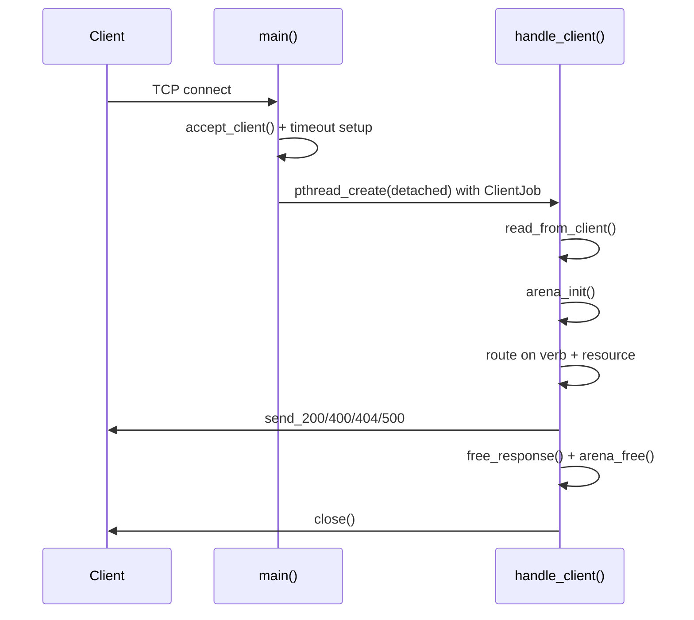

# CAPI

**CAPI's A Plain Interface.**

<p align="center">
  
</p>

A minimal HTTP/1.1 web API written in C. The goal here is simplicity and little dependencies.

`CAPI` stands for **CAPI is A Plain Interface**. The mascot is a brazilian capybara.

---

## Dependencies

- Linux / POSIX (sockets, `pthreads`, `gmtime_r`, `/dev/urandom`)
- GCC or Clang with C11 support

---

## Quick start

### 1. Build the build tool (once)

`forge` is the project's build driver. Build it once with:

```sh
gcc -o forge forge.c
```
and just call `forge` whenever you want to compile Capi.

### Important
`forge` shells out to:

```sh
gcc -o build/capi -g -Wall -Wextra -Icore/src -Ilibs api/api.c -pthread
```

### 2. Run the server

Run from the repository root — the `/` route reads `./frontend/index.html`:

```sh
./build/capi
```

Open <http://localhost:6969> or call the endpoints with `curl`.

---

## Routes

All routes are hard-coded in the block of `handle_client()` in
`api/api.c`.

### `GET /`

Serves `frontend/index.html` as `text/html`. If the file cannot be read, returns `404`.

```sh
curl http://localhost:6969/
```

### `GET /capi.svg`

Serves `frontend/capi.svg` as `image/svg+xml`. It is the capybara mascot shown on
the index page and used as the favicon.

```sh
curl http://localhost:6969/capi.svg
```

### `GET /hasUrlParam/<name>`

It is an example of a generic GET endpoint.

Reads the value of the `paramValue` query parameter. If the query string has no
`paramValue`, the route falls back to a JSON body with a `paramValue` string
property (useful for `GET` requests sent with a body).

```sh
curl "http://localhost:6969/hasUrlParam/anything?paramValue=hello"
```

or:

```sh
curl -X GET http://localhost:6969/hasUrlParam/anything \
     -H 'Content-Type: application/json' \
     -d '{"paramValue":"hello"}'
```

### `POST /hasBodyParam`

It is an example of a generic POST endpoint.

Reads the `bodyParam` string property from the JSON request body and echoes it
back as the response body.

```sh
curl -X POST http://localhost:6969/hasBodyParam \
     -H 'Content-Type: application/json' \
     -d '{"bodyParam":"hello"}'
```

---

## Adding a route

A new route is just another branch.

Example for a `GET /health` endpoint:

```c
case VERB_GET:
    if (strcmp(res.resource, "/") == 0) {
        /* serve a file */
    }
    else if (strcmp(res.resource, "/health") == 0) {
        char *body = "{\"status\":\"ok\"}";
        free_response(&res);
        send_200_to_client_json(client, body, (int)strlen(body));
    }
    else {
        send_404_to_client(client);
    }
    break;
```

Key points:

- Always call `free_response(&res)` once you are done reading `res.resource`,
  `res.query` and `res.body`. They are heap-allocated by `read_from_client()`.
- Use the `send_*` helpers instead of writing to the socket manually.
- `payload` is a fixed `PAYLOAD_SIZE` (8 KiB) stack buffer; requests larger than
  that are truncated.
- `VERB_QUANTITY_` is checked with `static_assert` so adding a new verb to the
  enum forces you to update the switch.

### Per-request scratch memory

Each request gets its own `Arena`:

```c
Arena arena;
arena_init(&arena);

char *copy = arena_strdup(&arena, res.resource);
/* ... */

arena_free(&arena);
```

Anything that must outlive the request (shared state, caches, maps) must use
`malloc`/`strdup`, not the arena, or it will dangle after `arena_free()`.

### Client jobs

`main()` hands each accepted socket to a detached thread through a `ClientJob`
struct. Extend that struct to pass request-scoped context into `handle_client()`:

```c
typedef struct {
    int client;
    char *example;
    /* add more per-connection data here */
} ClientJob;
```

### Shared state

Handlers run concurrently, so any shared mutable state must be guarded. A mutex
is already sketched in the file:

```c
static pthread_mutex_t your_lock = PTHREAD_MUTEX_INITIALIZER;

pthread_mutex_lock(&your_lock);
/* read/write shared state */
pthread_mutex_unlock(&your_lock);
```

---

## Libraries

The headers in `libs/` are STB-style single-header libraries: declarations are
always visible, and the implementation is compiled only in the translation unit
that defines the matching macro before including the header.

| Header | Macro | Overview |
| --- | --- | --- |
| `ahb_lib.h` | `AHB_LIB_IMPLEMENTATION` | General utilities: logging, command execution, args, string builders, hash map, file helpers, temp allocator, colors |
| `arena.h` | `ARENA_IMPLEMENTATION` | Bump allocator for request-scoped scratch memory |
| `json.h` | `JSON_IMPLEMENTATION` | Minimal JSON parser with typed object/array accessors |
| `network.h` | `NETWORK_IMPLEMENTATION` | Loopback TCP server/client, HTTP request parsing and response helpers |

Define each macro in exactly one translation unit; `api.c` does this for all
four. Note that `network.h` also defines `AHB_LIB_IMPLEMENTATION`, so a file
including it must not include `ahb_lib.h` with its implementation again.

---

## Request lifecycle



---

## Limitations

These are intentional for a teaching-sized framework:

- Listens only on `127.0.0.1`; the address is not configurable, only the port.
- Request payloads are capped at 8 KiB (`PAYLOAD_SIZE`); paths and query strings
  are capped at 256 bytes.
- Only `GET` and `POST` are distinguished; any other method is treated as `GET`.
- No TLS, no keep-alive, no chunked transfer encoding, no HTTP parsing hardening.
- `send_400_to_client()` emits the status line `400 Not Found` instead of
  `400 Bad Request`.

Do not expose this server to a network without adding proper request limits,
timeouts and TLS in front of it.

---

## Troubleshooting

**`Could not load the file index.html`** — the server was not started from the
repository root. `cd` to the project root and run `./build/capi`.

**`Could not bind the server to port 6969`** — another process is using the port:

```sh
ss -ltnp | grep 6969
```

**Rebuild after editing headers** — `forge` recompiles `api/api.c`, which is the
only translation unit with the library implementations, so a single
`./forge api` is enough.
